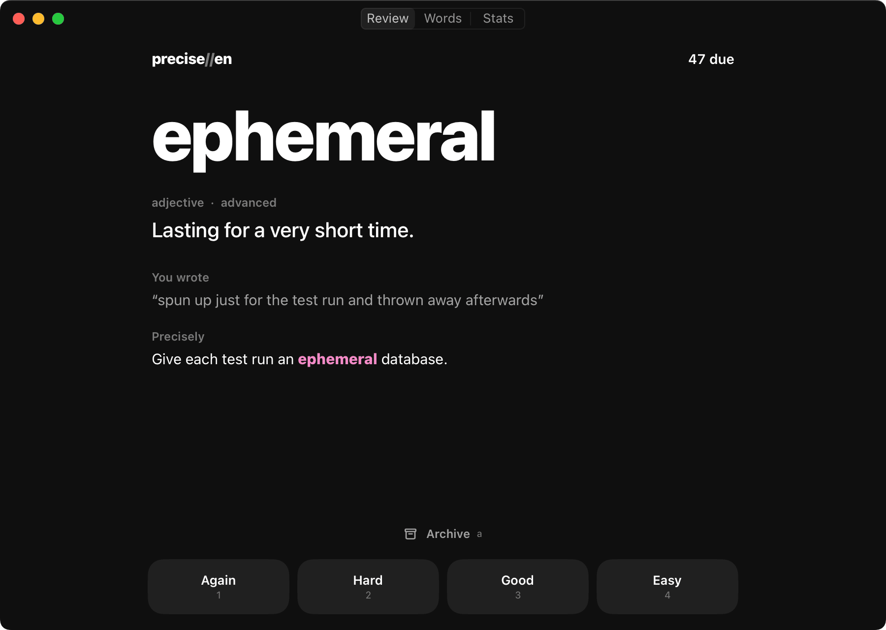
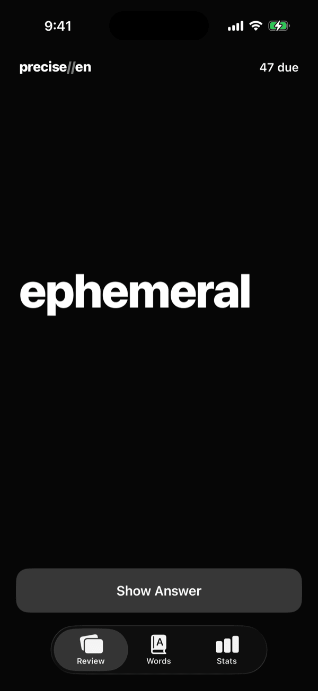
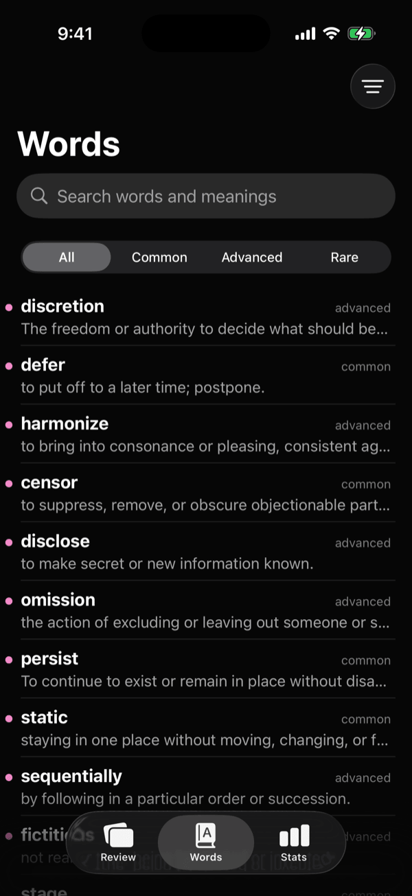
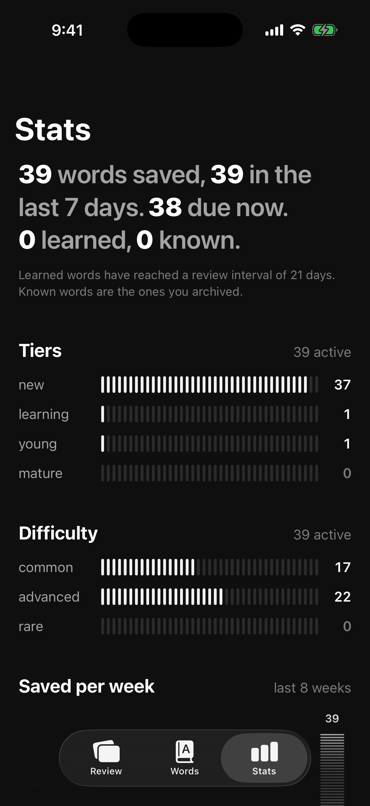

# precise//en

<p align="center">
  <a href="LICENSE"></a>
  
  
  
  
</p>

<p align="center">
  
  
  <a href="https://zazencodes.com/"></a>
</p>

Learn the English words you could have used in your own prompts.

When you send Claude Code or Codex a long prompt, precise//en asks a cheap background model for the one word that would have said part of it better, such as **idempotent** for *make sure running it twice doesn't break anything*. It saves the word with its definition, difficulty (`common`, `advanced` or `rare`), your phrase and a tighter rewrite of the prompt. A Mac menu bar app shows how many new words have arrived and reviews them with spaced repetition, Anki-style. An iPhone app reviews the same words.

<p align="center">
  
</p>

<p align="center">
  
  
  
</p>

## Features

- **Words from your own writing.** Every prompt of 50 words or more is a chance to learn one word: the background agent finds a phrase you wrote that one word says better, or nothing when the prompt is already precise.
- **Never in your way.** The hook returns at once and prints nothing, so your agent never waits and never sees it.
- **Review, Anki-style.** A card shows the word. Show Answer (Space on the Mac) reveals its part of speech, difficulty and definition, your own phrase under *You wrote*, and the rewrite with the word in pink under *Precisely*. Rate it Again, Hard, Good or Easy (1 to 4 on the Mac), and it comes back when it is due.
- **Words.** Every word with its definition and difficulty, a pink dot on each new one until you open it. Filter by difficulty, sort by newest or A–Z, and search words and meanings.
- **Archive what you know.** Swipe a word away and it leaves review for good. It stays in your list, so it is never suggested again; Show Archived Words brings it back.
- **Stats.** Words saved, due, learned and known in one sentence, and every word drawn as a tick by tier, by difficulty and by the week you saved it.
- **The Mac and the iPhone in step.** One word list in Cloudflare D1, behind a small Worker that keeps the review schedule, so a word you review on one is done on the other.

## How it works

```
prompt ──▶ UserPromptSubmit hook ──▶ precise-en suggest (detached)
                                       │  tmux-agent-plane background "<prompt>"
                                       ▼
                     Cloudflare Worker + D1 ◀── Mac app (menu bar) and iPhone app
```

- **Hook.** `precise-en hook` returns at once. Prompts under 50 words are skipped. Longer ones go to `precise-en suggest`, which runs the background agent you chose in [tmux-agent-plane](https://github.com/zazencodes/tmux-agent-plane) (`o` → Configure), checks its answer (including a valid `difficulty`) and saves the word. It refuses a word already in the prompt, a phrase you didn't write, and any word you have already saved, including words you archived as known.
- **Worker.** One D1 table holds every word, its difficulty and its review state, including archived words so they are never suggested again. The Worker requires a bearer token, schedules reviews, and archives or restores words.
- **Apps.** The Mac app lives in the menu bar: it counts new words, opens at login and opens one window with Review, Words and Stats. The iPhone app has the same three screens.

**What leaves your Mac.** Prompts of 50 words or more (up to 20,000 characters) go to the background agent's model, through that CLI's own login. Each saved word keeps your phrase, a quote from your prompt, and the rewrite, in your own D1 database. The apps have your Worker's URL and token built in, so keep your builds to yourself.

## Requirements

- A Mac with macOS 15 or newer, Xcode and [xcodegen](https://github.com/yonaskolb/XcodeGen) (`brew install xcodegen`)
- An Apple developer account, to sign the apps, and an iPhone with iOS 17 or newer for the iPhone app
- A Cloudflare account and Node 22
- [tmux-agent-plane](https://github.com/zazencodes/tmux-agent-plane) with a background agent chosen
- Claude Code or Codex

## Setup

**1. The Worker and its database.** Clone the repo, then in `worker/`:

```sh
git clone https://github.com/zazencodes/precise-en.git
cd precise-en/worker
npm ci
npx wrangler login
npx wrangler d1 create precise-en --update-config=false
npm run deploy
```

`wrangler.jsonc` names the database but holds no id: Wrangler finds `precise-en` in the Cloudflare account you're logged in to. `npm run deploy` creates the table, deploys the Worker and prints its URL, `https://precise-en.<your-subdomain>.workers.dev`.

**2. Your config.** Everything that is yours lives in `~/.config/precise-en/config.json`, outside the repo: the Worker's URL, the API token, and the Apple team and bundle ID the apps are signed with.

```json
{
  "url": "https://precise-en.<your-subdomain>.workers.dev",
  "token": "<a random token from: openssl rand -hex 32>",
  "apple_team_id": "<your Apple Developer Team ID>",
  "bundle_id": "com.<you>.preciseen"
}
```

Keep it private with `chmod 600 ~/.config/precise-en/config.json`. Your Team ID is under Membership details at [developer.apple.com/account](https://developer.apple.com/account). The bundle ID is any reverse-DNS name of your own; Apple refuses one another team has registered.

Then give the Worker the same token, from `worker/`:

```sh
python3 -c 'import json, os; print(json.load(open(os.path.expanduser("~/.config/precise-en/config.json")))["token"], end="")' \
  | npx wrangler secret put TOKEN
```

**3. The apps and the CLI.** From the repo root:

```sh
./install.sh          # the Mac app and the precise-en CLI
./install-iphone.sh   # the iPhone app
```

`./install.sh` builds the Mac app into `/Applications/precise::en.app` (Finder shows it as precise//en), opens it, adds it to Login Items and installs `precise-en` in `~/.local/bin`. `./install-iphone.sh` installs the iPhone app on your paired, unlocked iPhone.

Both sign with the Apple account you are signed in to in Xcode → Settings → Accounts. The Mac app needs an Apple Development certificate; if you have none, create one there under Manage Certificates.

The URL and token are built into the apps, so run both again after changing either.

**4. The background agent.** In tmux-agent-plane's sidebar or picker, press `o` → Configure, then choose and accept a background agent. Check it answers:

```sh
tmux-agent-plane background "Reply with one word: ready"
```

**5. The hook.** Add `precise-en hook` to `UserPromptSubmit` in `~/.claude/settings.json` (Claude Code) and `~/.codex/hooks.json` (Codex):

```json
{
  "hooks": {
    "UserPromptSubmit": [
      { "hooks": [{ "type": "command", "command": "/Users/<you>/.local/bin/precise-en hook" }] }
    ]
  }
}
```

Codex runs a new hook only after you trust it. Start Codex (it opens with "Hooks need review"; choose Review hooks) or run `/hooks`, select `UserPromptSubmit`, press Enter, select the `precise-en hook` entry and press `t`. Codex saves the trust in `~/.codex/config.toml` and asks again if the hook's entry changes.

Now write a long prompt. Within a minute or so, the menu bar counts one new word.

## Troubleshooting

- `~/.local/state/precise-en/capture.log` has one line per long prompt: `added`, `no-word`, `duplicate`, `rejected` (with why) or `failed` (with the error). When the latest is `failed`, the menu bar icon turns into a warning, with the error and the log one click away.
- Test a capture by hand: `echo "<a long prompt>" | precise-en suggest`. It saves a real word.
- `apps/configure.sh` says which key `config.json` is missing. It runs as part of every build.
- A menu bar manager such as Ice may hide the menu bar icon when it first appears.

## Development

```sh
swift test                                      # the Swift tests
cd worker && npm test && npm run typecheck      # the Worker's tests, in the Workers runtime, and its types
```

Set `DEVELOPER_DIR=/Applications/Xcode.app/Contents/Developer` if `xcode-select` points at the Command Line Tools. `./build.sh` builds `build/precise::en.app` and `build/precise-en` without installing them. `apps/configure.sh` generates `apps/PreciseEN.xcodeproj` from `apps/project.yml` for opening in Xcode. `swift apps/icon.swift` renders the //en icon into every Mac and iPhone size.

| Folder | Role |
|---|---|
| `worker/` | The Cloudflare Worker: the API, the review schedule (`src/schedule.ts`) and the D1 table (`migrations/`) |
| `Sources/PreciseKit` | The word model, the API client and the capture status, shared by everything below |
| `Sources/PreciseUI` | SwiftUI shared by both apps: Review, Words and Stats |
| `Sources/PreciseCLI` | `precise-en hook` and `precise-en suggest`; `Capture.swift` holds the prompt to the background agent and the checks on its answer |
| `apps/` | The Mac and iPhone apps (`project.yml`, for xcodegen) and the icon |

## Decisions

The decisions behind precise//en, and what was ruled out, are in [docs/adr](docs/adr):

- [Prompts reach precise-en through a prompt hook, not a skill](docs/adr/2026-11-15-prompts-reach-precise-en-through-a-hook.md)
- [One word list in Cloudflare D1, behind a Worker, shared by every device](docs/adr/2026-11-15-one-word-list-in-d1-behind-a-worker.md)
- [Review cards show the word and ask for its meaning](docs/adr/2026-11-15-cards-ask-for-the-meaning.md)
- [Known words are archived rather than deleted, and judged for difficulty at capture](docs/adr/2026-11-15-known-words-are-archived-and-judged-at-capture.md)
- [The Mac app's file name spells "precise//en" with colons](docs/adr/2026-11-16-the-mac-app-file-name-spells-the-name-with-colons.md)
- [Each person's own settings stay out of the repo](docs/adr/2026-11-16-each-persons-own-settings-stay-out-of-the-repo.md)

## Changelog

See [CHANGELOG.md](CHANGELOG.md). Releases are tagged `vX.Y.Z`.

## License

[GPLv3](LICENSE). You can use, modify and share this code, and any version you distribute must also be released under GPLv3.

<p align="center">
  <a href="https://zazencodes.com/?utm_source=github&utm_medium=referral&utm_campaign=precise-en">
    
  </a>
  <br>
  Created by <a href="https://zazencodes.com/">ZazenCodes</a>
</p>
